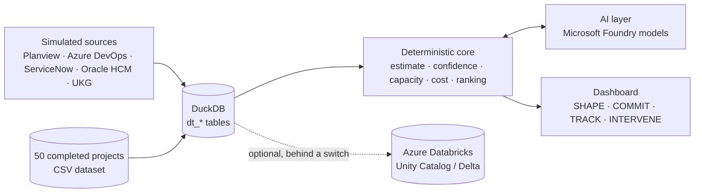

https://github.com/user-attachments/assets/0b13533f-0dc8-4d47-a9d4-8dee76a44e38


# Delivery Twin

**A delivery copilot that turns a project request into a commitment you can defend, then helps keep it.**
Delivery Twin estimates from similar completed projects, checks the commitment against real capacity,
watches delivery signals, and proposes recovery plans. The AI does the analysis, code does the math, and a person
makes every decision.

## The problem

- Delivery dates are committed from optimistic estimates and without considering who is actually available.
- The early warning signs are spread across separate systems: portfolio plans, sprint backlogs, incidents
  and change requests, HR records and time tracking.
- By the time a slip is visible, there is little room left to recover, and the trade-offs are argued from opinion.

## The solution: four stages

| Stage | What it does | Decision |
|---|---|---|
| **SHAPE** | Reads the request, a ROM and meeting notes. It asks clarifying questions, surfaces risks and dependencies (each with a verified source quote), and estimates P50/P80 effort from the closest completed projects. | Confirm the answers |
| **COMMIT** | Checks the estimate against capacity, the target date and scope. Shows on-time confidence, role × phase bottlenecks and an AI challenge of the plan. | Approve the baseline |
| **TRACK** | Compares delivery signals with the baseline every sprint. Shows how far on-time confidence moved and why, including portfolio conflicts. | Monitor |
| **INTERVENE** | Proposes recovery scenarios with cost and on-time odds. Tunes any scenario from a plain-English instruction until it meets a target. | Apply a plan |

TRACK and INTERVENE unlock only after a baseline is approved.

## Demo story

One synthetic request, *"We need one view of every customer across the business"*, end to end. The numbers come
from the seeded demo data with no AI key, so they are reproducible.

| Step | What you see |
|---|---|
| SHAPE | Closest analogs: Customer Data Lakehouse (95%), Customer Segmentation Feed (94%), Customer Identity Resolution (92%). Estimate **P50 4,650 h / P80 5,750 h**. |
| COMMIT | 7.0 of 8.5 FTE allocated: **84% on-time confidence** (89% chance of fitting capacity, 69% historical). Approve, and an Azure DevOps Epic → Feature → Story backlog is generated. |
| TRACK | Two healthy sprints: **82%**. |
| P0 preemption | A P0 regulatory project takes 2.5 FTE (400 h) in Sprints 3–4: on-time confidence drops to **34%**. |
| INTERVENE | **Composed re-plan: 80%, +$12,000** (re-sequence 120 h, borrow 1.5 FTE from a P3 project, backfill 0.5 FTE). Alternatives: re-sequence only 74% at $0; borrow 72% at $0; backfill 72% at +$60,000. |
| Tune | Type *"No extra budget"*: the AI re-plans the levers (borrow 2.0 FTE, defer 80 h, no contractors) and code re-scores them: **80% at $0**. |

## What makes it different

- **Estimates from evidence.** Every estimate comes from the three most similar completed projects, not a blank spreadsheet.
- **Honest AI.** The AI proposes, and code validates every answer. Confidence, cost, capacity and ranking are
  deterministic and unit-tested. When the AI is unavailable, results are clearly labeled rules-based.
- **Sources you can check.** Every finding in SHAPE shows where it came from, and quotes are verified word for word.
- **Portfolio-aware recovery.** A P0 preemption is re-planned across the portfolio (re-sequence, borrow, backfill),
  with the impact on the lending project shown.
- **Read-only and private by design.** Nothing is written back to enterprise systems. HR data is used only as
  role-level aggregates, and groups smaller than 3 people are suppressed.

## Architecture



- **App:** one Python process serving the API and a single-page dashboard. Agent Framework drives the four-stage workflow.
- **Data:** DuckDB, embedded in the app. Every table is prefixed `dt_`. Azure Databricks sits behind the same interface for later.
- **AI:** Microsoft Foundry models in Azure. OpenAI is used only for local testing.

## Impact (backtest on the synthetic portfolio)

| Metric | Result |
|---|---|
| External dependencies flagged at intake | **86%** (77 of 90), leave-one-out |
| Estimate spread vs original plans | **10% lower** (error SD 16.1 → 14.5 points) |
| Estimate error (MAPE) | 14.0% for original plans → **12.4%** from analogs |

These figures come from the synthetic 50-project dataset. They show the method works, not results from a real customer.

## Run locally

```powershell
python -m venv .venv
.\.venv\Scripts\Activate.ps1
python -m pip install -r src/requirements.txt
cd src
python -m deliverytwin serve        # http://127.0.0.1:8765/
```

- **Optional AI:** copy [`.env.example`](.env.example) to `.env` and set `OPENAI_API_KEY`. That's for local
  testing; without a key, the app runs on its labeled rules-based fallbacks.
- **Tests:** run these from the repository root.

  ```powershell
  python -m pip install -r requirements-dev.txt
  python -m unittest discover -s tests -t .
  ```

## Install on Azure

Delivery Twin runs on **Azure App Service** (Linux, Python 3.13) as a code deployment. You don't need a
container. Microsoft Entra ID sign-in protects every page, and the database is a DuckDB file on the app's
persistent `/home` storage.

### What you need

- An Azure subscription where you can create resource groups and app registrations.
- The Azure CLI (`az login`) and Python on the machine you deploy from.
- Outbound access from App Service to PyPI during deployment, or a private package index (see
  [Packages from Artifactory](#packages-from-artifactory-no-internet-access)).

### Option A: scripted install

```powershell
./infra/deploy.ps1 -ResourceGroup rg-deliverytwin -AppName deliverytwin-demo -Location eastus
```

The script:
1. creates the Entra ID app registration for sign-in;
2. deploys [`infra/main.bicep`](infra/main.bicep): the plan, web app, settings, health check and managed identity;
3. zips `src/` and pushes it.

Re-run it with `-SkipInfra` to push code only. Every option is in
[docs/deploy-azure-app-service.md](docs/deploy-azure-app-service.md).

### Option B: manual install (portal)

Turn on sign-in **before** the app goes live. The app has no login of its own.

1. **Create the web app.** Go to **Create a resource → Web App**.
   - **Resource group:** new, for example `rg-deliverytwin`.
   - **Name:** for example `deliverytwin-demo`.
   - **Publish:** Code. **Runtime:** Python 3.13. **OS:** Linux.
   - **Plan:** Basic B1 or higher.
2. **Turn on sign-in.** Go to **Settings → Authentication → Add identity provider**.
   - **Provider:** Microsoft, and create a new app registration.
   - **Account types:** current tenant only.
   - **Access:** require authentication, and redirect unauthenticated requests (HTTP 302).
3. **Add the app settings.** Go to **Settings → Environment variables**:

   | Name | Value |
   |---|---|
   | `SCM_DO_BUILD_DURING_DEPLOYMENT` | `true` |
   | `DELIVERYTWIN_HOST` / `DELIVERYTWIN_PORT` | `0.0.0.0` / `8000` |
   | `DELIVERYTWIN_DB_PATH` | `/home/data/deliverytwin.duckdb` |
   | `DELIVERYTWIN_TRUSTED_AUTH` | `1` (only with step 2 done) |
   | `DELIVERYTWIN_DEMO_MODE` | `1` |
   | `DELIVERYTWIN_FOUNDRY_ENABLED` / `DELIVERYTWIN_DATABRICKS_ENABLED` | `0` / `0` |

   Don't add `OPENAI_API_KEY`; the app ignores it on App Service.
4. **Set startup, health check and identity.**
   - **Configuration → General settings:**
     - **Startup Command:** `python -m deliverytwin serve`
     - **Always On:** On. **HTTPS Only:** On. **FTP:** Disabled.
   - **Monitoring → Health check:** path `/healthz`.
   - **Identity → System assigned:** On.
5. **Build and push the code.** From the repository root:

   ```powershell
   python scripts/package_app.py
   az webapp deploy --resource-group rg-deliverytwin --name deliverytwin-demo `
       --src-path dist/deliverytwin-app.zip --type zip
   ```

   App Service installs `requirements.txt` during the deploy, which takes a few minutes the first time.
   Without the CLI, use **Advanced Tools (Kudu) → Tools → Zip Push Deploy** and drag the zip in.

### Packages from Artifactory (no internet access)

When App Service can't reach the internet, point the deploy-time `pip install` at your Artifactory PyPI
repository. pip reads its index from the `PIP_INDEX_URL` app setting.

1. **Find the index URL.** Use a PyPI *virtual* repository in Artifactory that proxies PyPI:
   `https://<artifactory-host>/artifactory/api/pypi/<pypi-virtual-repo>/simple`.
   If it needs credentials, include them in the URL:
   `https://<user>:<token>@<artifactory-host>/artifactory/api/pypi/<pypi-virtual-repo>/simple`.
2. **Set it before the first code push.**
   - **Scripted:** `./infra/deploy.ps1 … -PipIndexUrl "https://<user>:<token>@<artifactory-host>/artifactory/api/pypi/<repo>/simple"`.
   - **Manual:** add `PIP_INDEX_URL` under **Settings → Environment variables**.
   - **Private certificate authority:** if Artifactory's certificate comes from a private CA that App Service doesn't
     trust, also add `PIP_TRUSTED_HOST=<artifactory-host>`. Trusting your CA is the better fix if your platform team can do it.
3. **Keep the token out of plain settings.** Store the full URL as a Key Vault secret and set the app setting to
   `@Microsoft.KeyVault(SecretUri=https://<vault>.vault.azure.net/secrets/<name>/)`. Grant the web app's managed
   identity **Key Vault Secrets User** on the vault.
4. **Make sure the network allows it.** App Service needs a route to Artifactory, usually VNet integration plus
   DNS for a private host. The install runs in App Service's deployment container, so confirm with your network
   team that deployment traffic also follows that route.
5. **Push the code** (step 5 of option B, or re-run the script). The log stream should show pip downloading from
   your Artifactory host. Check that Artifactory has cached every package in `src/requirements.txt` (and
   `src/requirements-databricks.txt` if you use Databricks).

### Turn on Foundry models

1. **Settings:** set `FOUNDRY_PROJECT_ENDPOINT`
   (`https://<resource>.services.ai.azure.com/api/projects/<project>`) and `FOUNDRY_MODEL` (your deployment name).
   Then change `DELIVERYTWIN_FOUNDRY_ENABLED` to `1`. The scripted equivalent is `-EnableFoundry`
   `-FoundryProjectEndpoint … -FoundryModel …`.
2. **Access:** give the web app's managed identity **Cognitive Services OpenAI User** on the Foundry resource, and
   **Azure AI User** on the project for the chat.
3. **Restart:** restart the app. The log stream then shows `AI: foundry`.

### Check and operate

- **Log stream:** shows `Data: duckdb · AI: … · Databricks: off · Foundry: …` at startup.
- **Sign-in:** `https://<app>.azurewebsites.net` asks you to sign in, then opens the dashboard.
- **Health check:** if it reports unhealthy because sign-in blocks it, run
  `az webapp auth update -g <rg> -n <app> --excluded-paths "[\"/healthz\"]"`.
- **One instance:** keep the plan at one instance, because DuckDB is a single-writer file.
- **Data:** the database on `/home` survives restarts and starts empty, so load demo data from the dashboard.
- **Code updates:** repeat the code push (option B step 5, or `deploy.ps1 -SkipInfra`).
- **Untested:** none of this has been run against a live subscription yet.

## Configuration

Two switches control the cloud integrations. Both are off by default.

| Switch | When on (`1`) |
|---|---|
| `DELIVERYTWIN_FOUNDRY_ENABLED` | AI features and chat use the Foundry model in `FOUNDRY_PROJECT_ENDPOINT` + `FOUNDRY_MODEL` (managed identity in Azure) |
| `DELIVERYTWIN_DATABRICKS_ENABLED` | The application tables move to Unity Catalog / Delta once `DATABRICKS_HTTP_PATH` is set |

On Azure App Service only Foundry models are used. `OPENAI_API_KEY` is ignored there and never deployed.
Every setting is listed in [`.env.example`](.env.example).

## Switch to Azure Databricks

Only the five application tables move to Unity Catalog / Delta: baselines, intake sessions, recovery scenarios
and their target updates, and TRACK snapshots. The simulated source records and the historical dataset stay in a
local DuckDB file, and models still come from Foundry. No code changes are needed.

1. **Prepare Databricks.**
   - **Workspace and warehouse:** a workspace with Unity Catalog, and a SQL warehouse. Note its HTTP path from
     **Connection details**, for example `/sql/1.0/warehouses/<id>`.
   - **Schema:** a dedicated catalog and schema (default `dpm_dev.mlops`).
   - **Identity:** a service principal, or a personal access token for a local test.
   - **Permissions:** **CAN USE** on the warehouse, and **USE CATALOG**, **USE SCHEMA**, **CREATE TABLE**,
     **SELECT** and **MODIFY** on the schema. The smoke test in step 3 also needs **CREATE SCHEMA** on the catalog.
2. **Configure.** Install the libraries with `python -m pip install -r src/requirements-databricks.txt`, then set:

   ```
   DELIVERYTWIN_DATABRICKS_ENABLED=1
   DATABRICKS_HOST=https://adb-<id>.<n>.azuredatabricks.net
   DATABRICKS_HTTP_PATH=/sql/1.0/warehouses/<id>
   DATABRICKS_TOKEN=<token>          # or DATABRICKS_CLIENT_ID + DATABRICKS_CLIENT_SECRET
   DELIVERYTWIN_CATALOG=dpm_dev
   DELIVERYTWIN_SCHEMA=mlops
   ```

   The data moves only when the switch is `1` and both the host and the HTTP path are set.
3. **Smoke test.** Run `python -m deliverytwin databricks-smoke` from `src/`.
   - It creates a throwaway schema, creates the tables, loads the dataset, reads it back and writes a baseline.
   - It prints PASS or FAIL for each check, then drops the schema.
4. **Switch.** Restart the app. The startup line shows `Data: databricks`. Local baselines and scenarios don't
   migrate, so approve a baseline again in COMMIT.
5. **On Azure App Service.**
   - **Scripted:** `./infra/deploy.ps1 … -EnableDatabricks -DatabricksHost … -DatabricksHttpPath … -DatabricksToken …`.
     This also installs the Databricks libraries.
   - **Manual:** add the same app settings, package with `python scripts/package_app.py --with-databricks`, and
     deploy the zip.
   - **Token:** store it as a Key Vault reference.

**How the tables are deployed.** The app creates each table the first time it uses it, with
`CREATE TABLE IF NOT EXISTS <catalog>.<schema>.dt_<name> (…) USING DELTA`.
- **Columns and keys:** `STRING`, `BIGINT`, `DOUBLE`, `DATE` and `TIMESTAMP` columns, with `NOT NULL` keys and an
  informational `PRIMARY KEY`.
- **Writes:** `MERGE INTO`, so writes are upserts.
- **Creating them in advance:** run [`scripts/databricks_ddl.sql`](scripts/databricks_ddl.sql) in the SQL editor.
  It has all 12 tables for `dpm_dev.mlops`; regenerate it for another schema with
  `python -m deliverytwin ddl --catalog <c> --schema <s>`.
- **Schema changes:** existing tables are never altered, so a later column change needs a manual `ALTER TABLE`.

**Switch back** with `DELIVERYTWIN_DATABRICKS_ENABLED=0` and a restart. Nothing in the warehouse is deleted, and
nothing is copied back. The Databricks adapter has so far been tested only against a fake connection, so run the
smoke test before relying on it.

## Repository layout

```
src/                 deployable app: deliverytwin/ package, data/ files, requirements, Dockerfile
  deliverytwin/      server, dashboard, stage logic, AI layer, storage/ (data layer)
  data/              historical dataset (CSV) and demo samples
scripts/             maintenance: dataset generator, Databricks smoke test and DDL, App Service packager
tests/               unit and browser tests
infra/               Azure App Service template and deploy script
docs/                deployment guide and screenshots
```

## Status and limits

- **Prototype on synthetic data.** There are no live connectors; Azure DevOps output is a preview and a CSV.
- **Not yet run against live cloud services:** Foundry, Databricks and the App Service template are covered by
  unit tests against fake endpoints only.
- **Single instance:** the local DuckDB file has one writer. Shared or scaled-out data needs the Databricks layer.

## Roadmap

1. Deploy to Azure App Service with Foundry models.
2. Move the application tables to Azure Databricks.
3. Replace simulated sources with read-only connectors (Planview, Azure DevOps, ServiceNow, UKG).
4. Calibrate the estimates on real completed projects.

## Screenshots

| SHAPE | COMMIT |
|---|---|
|  |  |
| **TRACK** | **INTERVENE** |
|  |  |
