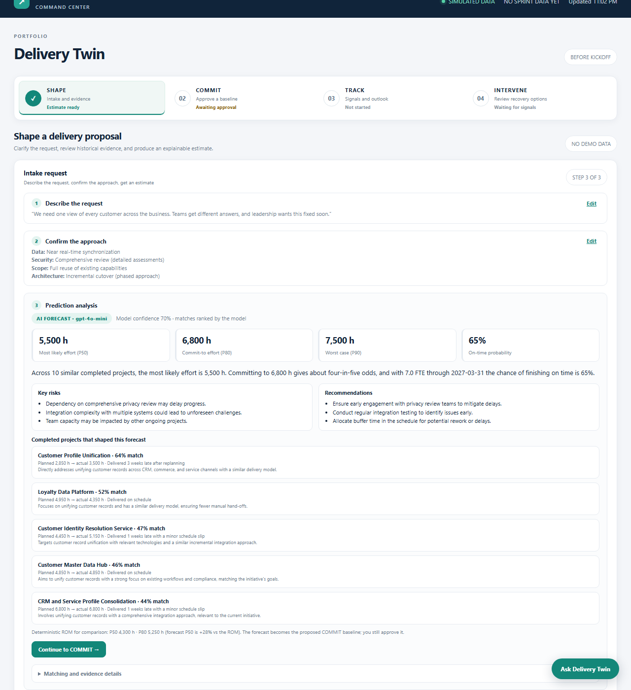
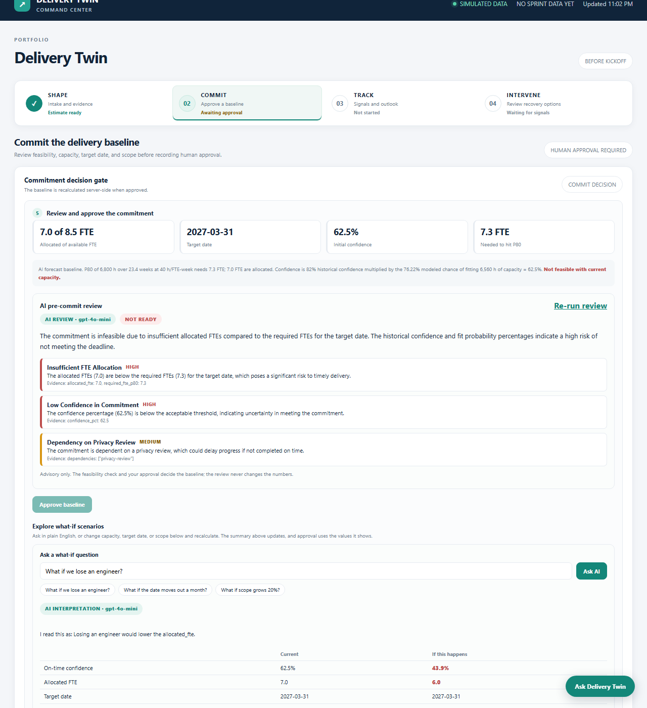
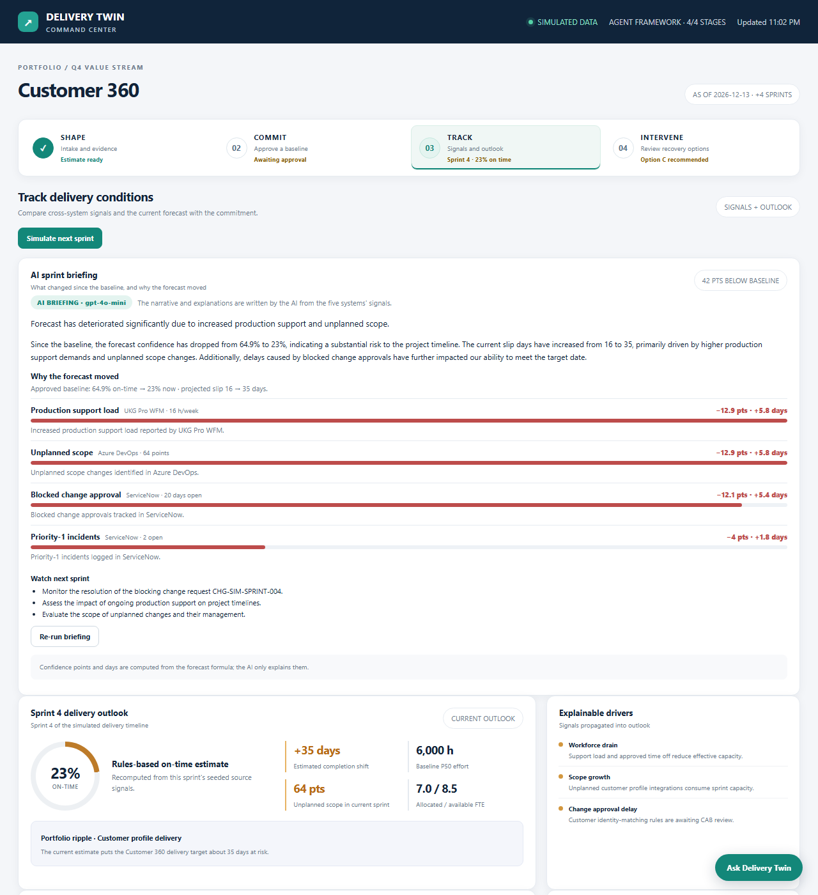
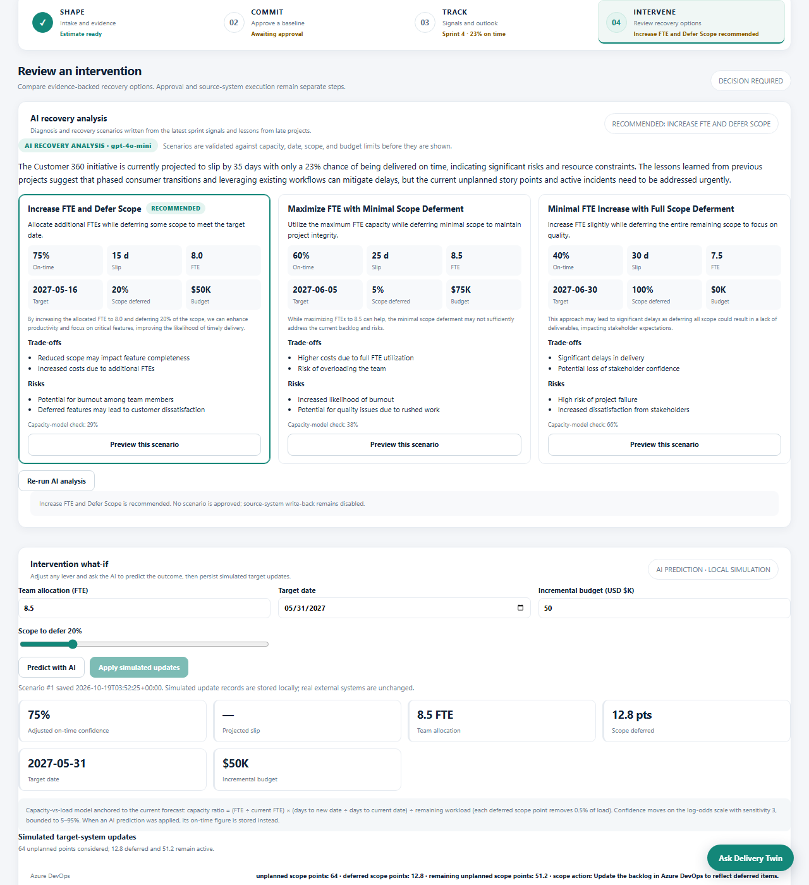
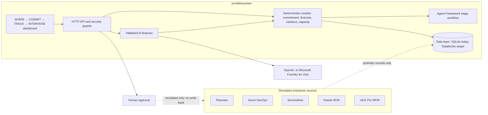

# Delivery Twin

Delivery Twin is a delivery-forecasting prototype that guides a request through four stages: **SHAPE → COMMIT → TRACK → INTERVENE**. An AI model does the analysis at every stage, and a person makes every decision. Each AI answer is validated before it is shown. If the AI is unavailable or its answer fails validation, the page falls back to a clearly labeled rules-based result.

All source data is synthetic. There are no live connectors, and nothing is ever written back to an enterprise system.

| Stage | What happens | AI's role | Human decision |
|---|---|---|---|
| **SHAPE** | Describe a request, confirm clarifying questions, get an estimate | Writes the questions, forecasts P50/P80/P90 effort and on-time odds from similar completed projects | Confirm the answers |
| **COMMIT** | Check feasibility against capacity, date, and scope | Challenges the commitment (risks and conditions); answers plain-English what-if questions | Approve the baseline |
| **TRACK** | Compare simulated delivery signals with the approved baseline | Explains what changed and why the forecast moved | None (monitoring) |
| **INTERVENE** | Compare recovery options and preview their effect | Diagnoses the problem, proposes scenarios, predicts outcomes | Apply a simulated scenario |

**TRACK and INTERVENE only unlock after a baseline is approved in COMMIT.** The server enforces this (HTTP 409), and the UI explains it.

## The four stages

### SHAPE: estimate from similar completed projects



SHAPE has three steps. Finished steps collapse to a summary with an **Edit** link, and an in-progress estimate is kept across a reload.

1. **Describe the request** (10–2,000 characters), or use the sample. You can attach PDF, DOCX, XLSX or text ROM documents and meeting notes (2 MB per file, 5 MB total). Scanned PDFs need OCR first.
2. **Confirm the approach.** The AI reads the request, the documents, and the most similar completed projects, then writes 4–6 tailored clarifying questions. Each carries a suggested answer and a rationale that names the projects behind it.
3. **Prediction analysis.** The AI forecasts P50, P80 and P90 effort, on-time probability, key risks, recommendations, and the completed projects that influenced it. The result is labeled `AI FORECAST · model` or `STATISTICAL ESTIMATE · AI FORECAST UNAVAILABLE`, and is compared with a deterministic ROM. The forecast becomes the proposed COMMIT baseline.

### COMMIT: challenge the commitment, then approve it



COMMIT compares the estimate with the time remaining and the team allocation. Required FTE is P80 effort at 40 hours per FTE-week. You can adjust allocated FTE (up to capacity), target date, and scope growth (0–50%). Confidence is the historical on-time rate multiplied by the modeled chance of fitting the effort into capacity, using a lognormal fit to the forecast's P50/P80/P90. **Approve baseline** is only enabled when the commitment is feasible. The server recomputes everything on approval.

- **AI pre-commit review** (`/api/intake/challenge`). The AI reads the server-computed commitment and the most similar completed projects, then lists the biggest risks with evidence and the conditions to attach before approving. It re-runs when you recalculate. It is advisory: the feasibility check and your approval decide.
- **What-if questions** (`/api/intake/ask`). Ask "What if we lose an engineer?" in plain English. The AI only translates the question into the same FTE / date / scope levers as the sliders. The commitment model computes the before-and-after table, and **Use these values** applies it. Questions that cannot be expressed as those levers, or fall outside their limits, are reported rather than clamped.

A collapsible **Estimate quality & portfolio impact** panel shows a leave-one-out backtest (MAPE of the plan and of the similarity-analog ROM against actual effort), time-to-first-ROM and seven-day intake volume. It is portfolio context only and does not affect any approval.

### TRACK: what changed since the baseline



**Simulate next sprint** loads or advances the synthetic records from five systems (Planview, Azure DevOps, ServiceNow, Oracle HR / HCM, UKG Pro WFM) by one 14-day sprint. The outlook is a transparent formula over those signals, not a Monte Carlo forecast.

The **AI sprint briefing** (`/api/track/brief`) explains in plain language what moved the forecast. Its variance table is **computed**: the forecast formula in [`workflow.py`](src/deliverytwin/workflow.py) assigns each signal a penalty, and the table scales those penalties to the confidence actually lost since the baseline. The AI only writes the narrative, a per-driver explanation naming the source system, and what to watch next. It is rejected if it skips a driver.

### INTERVENE: recover with AI-proposed scenarios



On entry, the AI diagnoses why the project is at risk and proposes 2–4 recovery scenarios (`/api/act/analyze`). Each scenario's FTE, date, scope-deferral and budget levers are validated against the same bounds as the manual what-if. A scenario outside those limits is removed and the page says so, and the recommended scenario is highlighted. Each card also shows a capacity-model cross-check next to the AI's predicted on-time odds, because the two can disagree.

- **Preview this scenario** reuses the AI's prediction with no extra call. Editing a lever invalidates it, and **Predict with AI** asks the model for the new outcome with commentary and per-system update text.
- **Apply simulated updates** stores per-system update records (Planview, Azure DevOps, ServiceNow, Oracle HR / HCM, UKG Pro WFM) in the local database. It is a simulation: no source data changes and nothing is written to a real system.

## How the AI is used

The same rules apply to every AI feature:

- **The model never produces the numbers a decision rests on.** Baseline confidence, the what-if outcomes, and the TRACK variance come from deterministic code. The model reads and explains them, or translates a question into levers for that code.
- **Every answer is validated** against a strict schema and bounds. Invalid output is rejected or removed, never repaired.
- **Fallbacks are truthful.** The page states why the AI was not used: no key configured, request failed (with the HTTP status), or response failed validation. It offers a retry where one makes sense.
- **Tests never call a real model.** The suite uses a scripted stand-in model.

With `OPENAI_API_KEY` set, the app uses OpenAI Chat Completions (`OPENAI_MODEL`, default `gpt-4o-mini`). Calls take a few seconds each, and the SHAPE estimate can take up to a minute.

## Run locally

Requires Python 3.10 or newer (the container image uses 3.14). From the repository root:

```powershell
python -m venv .venv
.\.venv\Scripts\Activate.ps1
cd src
python -m pip install -r requirements.txt
python -m deliverytwin demo     # create the database, load synthetic records, print a report
python -m deliverytwin serve    # dashboard at http://127.0.0.1:8765/
```

To enable the AI features, put `OPENAI_API_KEY=...` in a `.env` file in `src/` (or the repository root), or set it in the environment. `.env` is git-ignored. Restart the server after changing it.

Other commands (all from `src/`; pass `--db PATH` before the subcommand to use another SQLite file):

```powershell
python -m deliverytwin init                 # create the schema
python -m deliverytwin seed-demo            # load synthetic source records
python -m deliverytwin report               # print the signal report
python -m deliverytwin simulate --sprints 3 # advance the simulation (--reset clears it)
python -m deliverytwin generate-data        # regenerate the portfolio dataset CSVs
python -m deliverytwin ddl                  # print Databricks/Delta DDL
python -m deliverytwin databricks-smoke     # verify a live Databricks workspace
```

**Clear all demo data** (page footer) deletes every row in the local database after confirmation, keeping the schema. The `simulate` command bypasses the baseline gate, but the dashboard only shows simulated sprints once a baseline is approved.

### Tests

```powershell
cd src
python -m pip install -r requirements-dev.txt
python -m playwright install chromium       # once, for the browser tests
python -m unittest discover -s tests
```

The suite covers the data layer (SQLite and DuckDB contract tests), the AI features with a scripted model, and a Playwright test of the whole SHAPE → COMMIT → TRACK → INTERVENE journey. The browser tests are skipped if Chromium is unavailable.

## Repository layout

```
README.md
docs/screenshots/            screenshots used above
Delivery_Twin_Hackathon_Pitch.pdf
src/                         the deployable unit: Docker build context
  Dockerfile
  requirements.txt           runtime dependencies
  requirements-dev.txt       + DuckDB and Playwright for tests
  requirements-databricks.txt
  deliverytwin/              the Python package
    app.py                   HTTP server, routes, CLI, security guards
    dashboard.html           the single-page UI
    workflow.py              Agent Framework stage graph and the forecast formula
    intake.py                SHAPE and COMMIT logic
    commit_ai.py             COMMIT review and what-if questions
    track_ai.py              TRACK variance attribution and briefing
    recovery.py              INTERVENE scenarios and predictions
    ai_common.py, llm.py     shared AI helpers and the OpenAI client
    chat.py                  read-only "Ask Delivery Twin" assistant
    data/                    portfolio data layer, dataset, Databricks DDL
  tests/
```

## Architecture



Microsoft Agent Framework runs the four stages as deterministic executors; it orchestrates and is not the system of record. Locally it uses in-memory checkpoints. Set `AZURE_COSMOS_ENDPOINT` (optionally `AZURE_COSMOS_DATABASE_NAME` and `AZURE_COSMOS_CONTAINER_NAME`) to use the Cosmos DB checkpoint provider with `DefaultAzureCredential`. The provider package is prerelease, so pin and validate it for your environment.

### HTTP API

| Route | Purpose |
|---|---|
| `POST /api/intake/analyze` · `estimate` · `forecast` | SHAPE questions, the central estimate (forecast plus commitment), the forecast alone |
| `POST /api/intake/evaluate` · `what-if` · `approve` | COMMIT recalculation, scope simulation, approval |
| `POST /api/intake/challenge` · `ask` | COMMIT AI review and what-if questions |
| `POST /api/simulate` | Advance or reset the sprint simulation (needs an approved baseline) |
| `POST /api/track/brief` | TRACK AI briefing |
| `POST /api/act/analyze` · `what-if` · `apply` | INTERVENE scenarios, prediction, simulated apply |
| `POST /api/chat`, `GET /api/chat/status` | Read-only report chat |
| `GET /api/report`, `/api/intake/baseline`, `/api/impact`, `/healthz` | Report, latest baseline, portfolio metrics, health |
| `POST /api/reset-all` | Clear demo data (demo mode only) |

## Portfolio data layer

[`src/deliverytwin/data/`](src/deliverytwin/data) is the seam for moving the system of record from SQLite to Databricks. Outside its SQLite adapter, the layer does not use `sqlite3`.

| Piece | Purpose |
|---|---|
| [`schema.py`](src/deliverytwin/data/schema.py) | One definition of the seven portfolio tables plus four the app writes (`commitment_baselines`, `intake_sessions`, `recovery_scenarios`, `track_snapshots`), rendered per dialect. [`databricks_ddl.sql`](src/deliverytwin/data/databricks_ddl.sql) is the generated Unity Catalog / Delta DDL. |
| [`database.py`](src/deliverytwin/data/database.py) | A `Database` interface with positional `?` parameters, validated identifiers, and dialect upserts. Adapters: `SQLiteDatabase`, `DuckDBDatabase` (tests only), `DatabricksDatabase`. |
| [`repository.py`](src/deliverytwin/data/repository.py), [`app_repository.py`](src/deliverytwin/data/app_repository.py) | Portable history access, plus `BaselineRepository` and `IntakeSessionRepository`. |
| [`generator.py`](src/deliverytwin/data/generator.py) | A deterministic 50-project dataset (`HIST-001`…`HIST-050`) shaped like the `delivery_intel` Delta tables, checked in under [`delivery_intelligence/`](src/deliverytwin/data/delivery_intelligence). A test fails if the files drift from the generator. |

**Status.** The app runs on SQLite. COMMIT approvals and intake timing already go through the portable repositories; recovery scenarios and TRACK snapshots do not yet. The Databricks adapter is tested against a fake connection and has **not been run against a live workspace**. When you have access, install `requirements-databricks.txt`, set `DATABRICKS_SERVER_HOSTNAME` (or `DATABRICKS_HOST`), `DATABRICKS_HTTP_PATH`, optionally `DATABRICKS_TOKEN` (otherwise SDK default credentials), and `DELIVERYTWIN_CATALOG` / `DELIVERYTWIN_SCHEMA` (default `dpm_dev.mlops`), then run `python -m deliverytwin databricks-smoke`. It creates a throwaway schema, loads the dataset, reads it back, writes a baseline, reports PASS/FAIL per check, and drops the schema. Use a separate schema: the dataset adds extension columns (`delivery_pattern`, `actual_duration_weeks`, `outcome`, `dependency`) that existing `delivery_intel` tables may lack.

## Deploy to Azure

`src/` is self-contained: the `Dockerfile`, requirements and package sit together, so `src/` is the build context for Azure Container Apps, App Service for Containers, or an `azd` service. The image runs as a non-root user and serves port 8000.

```powershell
docker build -t deliverytwin src
docker run --rm -p 8000:8000 -e DELIVERYTWIN_TRUSTED_AUTH=1 -e OPENAI_API_KEY=... deliverytwin
```

This image has not been built or deployed from this repository yet, and there is no infrastructure-as-code. Plan for:

- **Authentication.** The server has no built-in authentication and refuses a non-loopback bind unless `DELIVERYTWIN_TRUSTED_AUTH=1` confirms an authenticating gateway (Entra ID, App Service authentication, Databricks Apps) fronts it. Use that flag only behind such a gateway.
- **Probes.** HTTP health probe at `/healthz` on port 8000.
- **Secrets.** Provide `OPENAI_API_KEY` (or the Foundry settings) through Key Vault references, never in the image or source control.
- **Storage.** The container's SQLite file is ephemeral. Move to Databricks (above) for durable data.
- **Foundry chat.** Set `FOUNDRY_PROJECT_ENDPOINT` and `FOUNDRY_MODEL` and use a managed identity with inference permission on the project. Chat prefers Foundry when both are set and otherwise falls back to `OPENAI_API_KEY`. Chat is read-only, limited to 1,200 characters per question and eight history messages, and treats conversation text as untrusted.

### Environment variables

| Variable | Effect |
|---|---|
| `OPENAI_API_KEY`, `OPENAI_MODEL` | Enable the AI features; model defaults to `gpt-4o-mini` |
| `FOUNDRY_PROJECT_ENDPOINT`, `FOUNDRY_MODEL` | Use Microsoft Foundry for chat |
| `DELIVERYTWIN_TRUSTED_AUTH` | Allow a non-loopback bind behind an authenticating gateway |
| `DELIVERYTWIN_DEMO_MODE` | Allow `/api/reset-all` and `/api/simulate` (default on for loopback, off otherwise; the image sets `0`, so **Simulate next sprint is disabled in the container** unless you turn it on) |
| `AZURE_COSMOS_ENDPOINT`, `AZURE_COSMOS_DATABASE_NAME`, `AZURE_COSMOS_CONTAINER_NAME` | Cosmos DB workflow checkpoints |
| `DATABRICKS_*`, `DELIVERYTWIN_CATALOG`, `DELIVERYTWIN_SCHEMA` | Databricks adapter |

## Scope and safety

- Every source is marked simulated with `writeback_enabled=0`. Applying an INTERVENE scenario or approving a baseline records simulated rows locally and changes nothing elsewhere.
- Cross-origin POST requests are rejected, request sizes are bounded, and destructive routes need demo mode.
- The sample server has no authentication or rate limiting. Do not expose it as a production service without identity, authorization and abuse protection.
- Screenshots use synthetic Customer 360 data and output from `gpt-4o-mini`; values change as the simulation advances.
