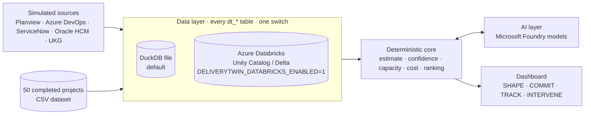

https://github.com/user-attachments/assets/0b13533f-0dc8-4d47-a9d4-8dee76a44e38


# Delivery Twin

**A delivery copilot that turns a project request into a commitment you can defend, then helps keep it.**
Delivery Twin estimates from similar completed projects, checks the commitment against real capacity,
watches delivery signals, and proposes recovery plans. The AI does the analysis, code does the math, and a person
makes every decision.

## The problem

- Delivery dates are committed from optimistic estimates and without considering who is actually available.
- The early warning signs are spread across separate systems: portfolio plans, sprint backlogs, incidents
  and change requests, HR records and time tracking.
- By the time a slip is visible, there is little room left to recover, and the trade-offs are argued from opinion.

## The solution: four stages

| Stage | What it does | Decision |
|---|---|---|
| **SHAPE** | Reads the request, a ROM and meeting notes. It asks clarifying questions, surfaces risks and dependencies (each with a verified source quote), and estimates P50/P80 effort from the closest completed projects. | Confirm the answers |
| **COMMIT** | Checks the estimate against capacity, the target date and scope. Shows on-time confidence, role × phase bottlenecks and an AI challenge of the plan. | Approve the baseline |
| **TRACK** | Compares delivery signals with the baseline every sprint. Shows how far on-time confidence moved and why, including portfolio conflicts. | Monitor |
| **INTERVENE** | Proposes recovery scenarios with cost and on-time odds. Tunes any scenario from a plain-English instruction until it meets a target. | Apply a plan |

TRACK and INTERVENE unlock only after a baseline is approved.

## Demo story

One synthetic request, *"We need one view of every customer across the business"*, end to end. The numbers come
from the seeded demo data with no AI key, so they are reproducible.

| Step | What you see |
|---|---|
| SHAPE | Closest analogs: Customer Data Lakehouse (95%), Customer Segmentation Feed (94%), Customer Identity Resolution (92%). Estimate **P50 4,650 h / P80 5,750 h**. |
| COMMIT | 7.0 of 8.5 FTE allocated: **84% on-time confidence** (89% chance of fitting capacity, 69% historical). Approve, and an Azure DevOps Epic → Feature → Story backlog is generated. |
| TRACK | Two healthy sprints: **82%**. |
| P0 preemption | A P0 regulatory project takes 2.5 FTE (400 h) in Sprints 3–4: on-time confidence drops to **34%**. |
| INTERVENE | **Composed re-plan: 80%, +$12,000** (re-sequence 120 h, borrow 1.5 FTE from a P3 project, backfill 0.5 FTE). Alternatives: re-sequence only 74% at $0; borrow 72% at $0; backfill 72% at +$60,000. |
| Tune | Type *"No extra budget"*: the AI re-plans the levers (borrow 2.0 FTE, defer 80 h, no contractors) and code re-scores them: **80% at $0**. |

## What makes it different

- **Estimates from evidence.** Every estimate comes from the three most similar completed projects, not a blank spreadsheet.
- **Honest AI.** The AI proposes, and code validates every answer. Confidence, cost, capacity and ranking are
  deterministic and unit-tested. When the AI is unavailable, results are clearly labeled rules-based.
- **Sources you can check.** Every finding in SHAPE shows where it came from, and quotes are verified word for word.
- **Portfolio-aware recovery.** A P0 preemption is re-planned across the portfolio (re-sequence, borrow, backfill),
  with the impact on the lending project shown.
- **Read-only and private by design.** Nothing is written back to enterprise systems. HR data is used only as
  role-level aggregates, and groups smaller than 3 people are suppressed.

## Architecture



- **App:** one Python process serving the API and a single-page dashboard. Agent Framework drives the four-stage workflow.
- **Data:** every table is prefixed `dt_` and lives in one engine. DuckDB, embedded in the app, is the default.
  With the Databricks switch on, all of it (historical dataset, simulated sources, simulation state, baselines,
  intake sessions, scenarios, snapshots) lives in Unity Catalog / Delta instead. Writes are portable upserts
  (`ON CONFLICT` on DuckDB, `MERGE INTO` on Databricks), and an empty schema is seeded from the checked-in samples
  at startup.
- **AI:** Microsoft Foundry models in Azure, through either a `*.services.ai.azure.com` models endpoint or an
  Azure OpenAI deployment. Locally, Databricks Model Serving and OpenAI can also be used for testing.

## Impact (backtest on the synthetic portfolio)

| Metric | Result |
|---|---|
| External dependencies flagged at intake | **86%** (77 of 90), leave-one-out |
| Estimate spread vs original plans | **10% lower** (error SD 16.1 → 14.5 points) |
| Estimate error (MAPE) | 14.0% for original plans → **12.4%** from analogs |

These figures come from the synthetic 50-project dataset. They show the method works, not results from a real customer.

## Run locally

```powershell
python -m venv .venv
.\.venv\Scripts\Activate.ps1
python -m pip install -r src/requirements.txt
cd src
python -m deliverytwin serve        # http://127.0.0.1:8765/
```

- **Optional AI and Databricks:** copy [`.env.example`](.env.example) to `.env` in `src/` or the repository root;
  `python -m deliverytwin` loads it on start. Set `OPENAI_API_KEY` for local testing, or the Foundry and
  Databricks settings. Without any key, the app runs on its labeled rules-based fallbacks.
- **Tests:** run these from the repository root.

  ```powershell
  python -m pip install -r requirements-dev.txt
  python -m unittest discover -s tests -t .
  ```

## Install on Azure

Delivery Twin runs on **Azure App Service** (Linux, Python 3.13) as a code deployment. You don't need a
container. Microsoft Entra ID sign-in protects every page, and the database is a DuckDB file on the app's
persistent `/home` storage.

```powershell
./infra/deploy.ps1 -ResourceGroup rg-deliverytwin -AppName deliverytwin-demo -Location eastus
```

The script creates the Entra ID app registration, deploys [`infra/main.bicep`](infra/main.bicep) and pushes the
code. Re-run it with `-SkipInfra` to push code only.

[docs/deploy-azure-app-service.md](docs/deploy-azure-app-service.md) has the full guide: every script option,
a manual portal install, installing packages from Artifactory when App Service has no internet access, turning
on Foundry models, and day-to-day operations.

## Configuration

Two switches control the cloud integrations. Both are off by default.

| Switch | When on (`1`) |
|---|---|
| `DELIVERYTWIN_FOUNDRY_ENABLED` | AI features and chat use the Foundry model in `FOUNDRY_PROJECT_ENDPOINT` + `FOUNDRY_MODEL` (managed identity in Azure) |
| `DELIVERYTWIN_DATABRICKS_ENABLED` | All sample, simulation, and operational tables use Unity Catalog / Delta (`DATABRICKS_HTTP_PATH` required) |

On Azure App Service only Foundry models are used. `OPENAI_API_KEY` is ignored there and never deployed.
Every setting is listed in [`.env.example`](.env.example).

## Switch to Azure Databricks

When enabled, all application data uses Unity Catalog / Delta: the historical project dataset, simulated
source-system records, simulation state, baselines, intake sessions, recovery scenarios and TRACK snapshots.
An empty configured schema is initialized from the checked-in synthetic samples at startup. DuckDB remains the
default when Databricks is disabled. Models still come from Foundry.

[docs/databricks.md](docs/databricks.md) covers the required permissions, configuration, the smoke test
(`python -m deliverytwin databricks-smoke`), the table DDL ([`scripts/databricks_ddl.sql`](scripts/databricks_ddl.sql))
and switching on App Service.

## Repository layout

```
src/                 deployable app: deliverytwin/ package, data/ files, requirements, Dockerfile
  deliverytwin/      server, dashboard, stage logic, AI layer, storage/ (data layer)
  data/              historical dataset (CSV) and demo samples
scripts/             maintenance: dataset generator, Databricks smoke test and DDL, App Service packager
tests/               unit and browser tests
infra/               Azure App Service template and deploy script
docs/                App Service and Databricks guides, screenshots
```

## Status and limits

- **Prototype on synthetic data.** There are no live connectors; Azure DevOps output is a preview and a CSV.
- **Not yet run against live cloud services:** Foundry, Databricks and the App Service template are covered by
  unit tests against fake endpoints only.
- **Single instance:** the local DuckDB file has one writer. Shared or scaled-out data needs the Databricks switch.
- **Use a dedicated Databricks schema:** *Clear all demo data* deletes the rows of every `dt_` table in it.

## Roadmap

1. Deploy to Azure App Service with Foundry models.
2. Validate the Databricks data layer (built, behind the switch) against a live workspace with the smoke test.
3. Replace simulated sources with read-only connectors (Planview, Azure DevOps, ServiceNow, UKG).
4. Calibrate the estimates on real completed projects.

## Screenshots

| SHAPE | COMMIT |
|---|---|
|  |  |
| **TRACK** | **INTERVENE** |
|  |  |
