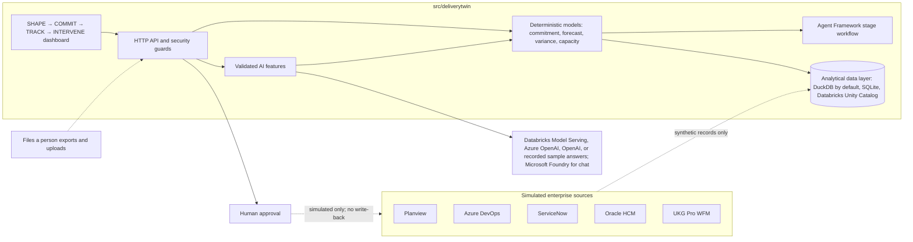
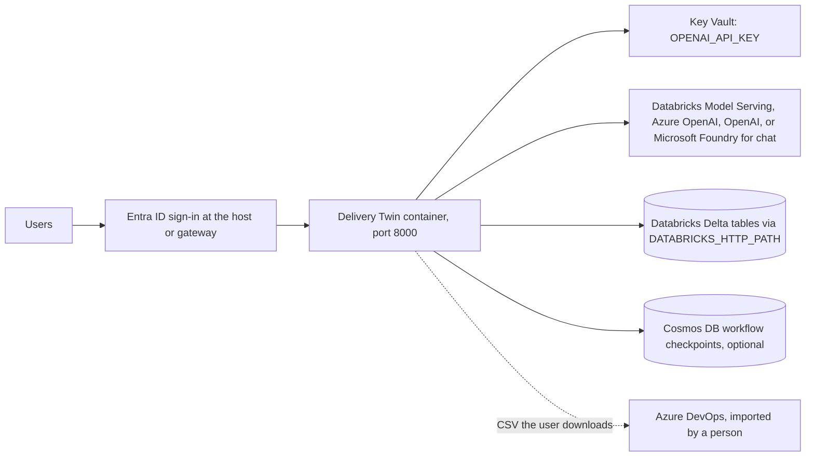

https://github.com/user-attachments/assets/61b6213e-1a1c-43e3-82cd-01cc7f7ed055

# Delivery Twin

Delivery Twin is a delivery-forecasting prototype that guides a request through four stages: **SHAPE → COMMIT → TRACK → INTERVENE**. An AI model does the analysis at every stage, and a person makes every decision. Each AI answer is validated before it is shown. If the AI is unavailable or its answer fails validation, the page falls back to a clearly labeled rules-based result.

All source data is synthetic. There are no live connectors, and nothing is ever written back to an enterprise system. That includes the Azure DevOps backlog: the app produces a preview and a CSV for you to import, and never calls Azure DevOps.

| Stage | What happens | AI's role | Human decision |
|---|---|---|---|
| **SHAPE** | Describe a request, confirm clarifying questions, get an estimate | Writes the questions, forecasts P50/P80/P90 effort and on-time odds from similar completed projects | Confirm the answers |
| **COMMIT** | Check feasibility against capacity, date, and scope | Challenges the commitment (risks and conditions); answers plain-English what-if questions | Approve the baseline |
| **COMMIT** (after approval) | Turn the approved baseline into an Azure DevOps Epic and Features | None (deterministic) | Import the CSV into Azure DevOps yourself |
| **TRACK** | Compare simulated delivery signals with the approved baseline | Explains what changed and why the forecast moved | None (monitoring) |
| **INTERVENE** | Compare recovery options and preview their effect | Diagnoses the problem, proposes scenarios, predicts outcomes | Apply a simulated scenario |

**TRACK and INTERVENE only unlock after a baseline is approved in COMMIT.** The server enforces this (HTTP 409), and the UI explains it.

## Demo walkthrough

One synthetic request, end to end. The numbers below come from the deterministic rules path (no AI key) on the seeded demo data with the *Capacity collision* scenario; they are reproducible, and with an AI configured the narrative and forecast change but the decision math does not. Dates and weeks move with the calendar, so the figures are for the seeded demo day (2026-02-20).

| Stage | What you do | What you see (sample numbers) |
|---|---|---|
| **SHAPE** | Click **Load full sample** (request + ROM + kickoff notes), **Analyze request** | 12 findings tagged `Stated in Request` (2) or `Found in Meeting Notes / ROM Document (Quote Verified)` (10, each with its quote); **3 external dependencies flagged, 0 named in the request text** (privacy review, consent management, CRM/MDM integration; the sample documents name them, the one-line request does not); closest analogs: Customer Data Lakehouse (96%), Customer Segmentation Feed (95%), Customer Identity Resolution Service (94%) |
| **SHAPE** | **Run prediction** | ROM **P50 4,650 h / P80 5,750 h** (analog median plus a 19% integration buffer) |
| **COMMIT** | Set 7.0 FTE and a 30 Sep 2026 target | P80 needs **4.5 FTE**; **7.0 of 8.5 FTE** allocated; confidence **68.5%** (69% historical × 99.3% capacity fit); feasible |
| **COMMIT** | Read **Role × Phase capacity** | 4 roles × 4 phases; **QA has 0 FTE planned**, so Build, Test and Cutover are flagged *unstaffed* (635 h of Test work with no capacity); **Privacy Guardrail Active**, HR groups under N = 3 suppressed |
| **COMMIT** | Look at the impact strip | **86% of dependencies caught at intake** (77 of 90, leave-one-out); **10% less estimate spread** than manual plans (error SD 16.1 → 14.5 points) |
| **COMMIT** | **Approve baseline** | Backlog tree (Epic → Features → Stories) and **Copy as ADO CSV**; nothing is sent to Azure DevOps |
| **TRACK** | **Simulate next sprint** ×3 | On-time odds fall to **26%**, projected slip **33 days** |
| **INTERVENE** | **Review recovery options** | Ranked by confidence, then cost, then date: **Contractors 39% on-time, +$168,143** (recommended); Squad reallocation 34%, +$33,429; Phase and unblock 34%, $0 |
| **INTERVENE** | **Apply simulated updates** | Per-system update records stored; the backlog gains a recovery-plan variant and a diff |

## Architecture at a glance (for judges)

- **Deterministic core, AI on the edges.** Feasibility, confidence, capacity-by-role, cost and ROI metrics are plain code you can unit test. The AI writes questions, narrative and scenario proposals, and every answer is validated or replaced by a labeled rules fallback.
- **Portable analytical data layer.** The system of record runs on **DuckDB by default**, an embedded analytical engine whose SQL and types match Databricks closely, with SQLite and **Azure Databricks (Unity Catalog / Delta)** behind the same interface. The same repositories, parameter style (`?`), and upsert semantics run on all three, and one environment variable (`DELIVERYTWIN_DB_DIALECT`) switches between them. Only [`data/database.py`](src/deliverytwin/data/database.py) knows which engine is underneath.
- **Cloud AI in priority order.** Databricks Model Serving, then Azure OpenAI, then OpenAI, then a labeled rules fallback.
- **Read-only by design.** Sources are simulated and the Azure DevOps hierarchy is a preview and CSV; nothing is written to an enterprise system.
- **Privacy built in.** Oracle HCM and UKG data are used only as role-level aggregates with an N ≥ 3 suppression threshold.

## The four stages

### SHAPE: estimate from similar completed projects


SHAPE has three steps. Finished steps collapse to a summary with an **Edit** link, and an in-progress estimate is kept across a reload.

1. **Describe the request** (10–2,000 characters), or use the sample. You can attach PDF, DOCX, XLSX or text ROM documents and meeting notes (2 MB per file, 5 MB total). Scanned PDFs need OCR first. **Load full sample** fills the request and attaches a ready-made ROM document and kickoff meeting notes (kept in [`data/samples/`](src/deliverytwin/data/samples)) in one click.
2. **Confirm the approach.** The AI reads the request, the documents, and the most similar completed projects, then writes 4–6 tailored clarifying questions. Each carries a suggested answer and a rationale that names the projects behind it. Above the questions, **extracted facts, risks and dependencies** carry a source badge: `Stated in Request`, `Found in Meeting Notes (Quote Verified)` (or `ROM Document`), or `AI Inference (Confirm)`. When the AI attributes a finding to your request or an uploaded document it must supply a quote, and code checks that the quote appears **word for word** in that text (case and whitespace ignored, at least three words). A missing, too-short or non-matching quote is downgraded to `AI Inference (Confirm)` and says why. The same badges and verification apply to each question's rationale. See [`provenance.py`](src/deliverytwin/provenance.py).
3. **Prediction analysis.** The AI forecasts P50, P80 and P90 effort, on-time probability, key risks, recommendations, and the completed projects that influenced it. The result is labeled `AI FORECAST · model` or `STATISTICAL ESTIMATE · AI FORECAST UNAVAILABLE`, and is compared with a deterministic ROM. The forecast becomes the proposed COMMIT baseline.

### COMMIT: challenge the commitment, then approve it


COMMIT compares the estimate with the time remaining and the team allocation. Required FTE is P80 effort at 40 hours per FTE-week. You can adjust allocated FTE (up to capacity), target date, and scope growth (0–50%). Confidence is the historical on-time rate multiplied by the modeled chance of fitting the effort into capacity, using a lognormal fit to the forecast's P50/P80/P90. **Approve baseline** is only enabled when the commitment is feasible. The server recomputes everything on approval.

- **AI pre-commit review** (`/api/intake/challenge`). The AI reads the server-computed commitment and the most similar completed projects, then lists the biggest risks with evidence and the conditions to attach before approving. It re-runs when you recalculate. It is advisory: the feasibility check and your approval decide.
- **What-if questions** (`/api/intake/ask`). Ask "What if we lose an engineer?" in plain English. The AI only translates the question into the same FTE / date / scope levers as the sliders. The commitment model computes the before-and-after table, and **Use these values** applies it. Questions that cannot be expressed as those levers, or fall outside their limits, are reported rather than clamped.

A collapsible **Estimate quality & portfolio impact** panel shows a leave-one-out backtest (MAPE of the plan and of the similarity-analog ROM against actual effort), time-to-first-ROM and seven-day intake volume. A **calibration** section checks the P50 and P80 bands the same way: how often real effort fell at or below each band (targets 50% and 80%), the average estimate bias, and how often projects finished on time. It is portfolio context only and does not affect any approval.

- **Role × Phase capacity** ([`capacity.py`](src/deliverytwin/capacity.py)). Next to the unchanged aggregate FTE check, the P80 effort is spread across Discovery, Build, Test and Cutover and across Data Engineering, Integration / Backend, QA and Security & Privacy, using the delivery fingerprint (complexity, systems, roles, dependencies). Each cell compares required hours with the planned team's hours in that phase: above 100% is a *bottleneck*, above 85% is *tight*, and a role with no planned FTE is *unstaffed*. It is a deterministic planning aid, not a measurement of real utilization.
- **HR privacy guardrail.** The badge reads *Privacy Guardrail Active: Oracle HCM & UKG capacity aggregated at role level only (minimum N >= 3 anonymity threshold; worker-level PII isolated).* The code enforces it: worker names and ids never leave `capacity.py`, a role group with fewer than three workers is suppressed rather than reported, and only one team-wide time-off factor is used. In the synthetic data every role has fewer than three people, so every role group is suppressed.
- **Impact strip.** COMMIT and INTERVENE show two deterministic ROI metrics, with the same strip in the impact panel. *Early dependency detection*: the share of completed projects' approval-gate dependencies that SHAPE flags from the three closest analogs alone (leave-one-out; 77 of 90 = 86%, precision 79%). The history has no record of dependencies discovered mid-flight, so no mid-flight baseline is claimed; per request, the strip also shows how many dependencies SHAPE flagged versus how many the request text names. *Estimator variance reduction*: the spread (standard deviation) of the signed % error against actual effort, original plans versus the analog estimate (16.1 → 14.5 points, a 10% reduction). Both come from code over the synthetic history and are shown even when the improvement is small.

**After approval**, COMMIT also shows the following. None of it involves a model, and each item is labeled with where its data came from (synthetic, uploaded, or computed by code).

- **Azure DevOps backlog** (`/api/commit/backlog`). One Epic, its Features and their User Stories as an expandable tree. Feature efforts add up to the approved P50, dates fall inside the committed window, and Features come from the delivery fingerprint (discovery, each external dependency, each in-scope system, test and cutover). Each Feature's hours are split across roles by the planned team, and each User Story comes from an acceptance criterion. The P50-to-P80 gap is shown as schedule risk, not scope.
- **Backlog follows the plan.** When an INTERVENE scenario is applied, a second backlog is built with the new target date and the deferred share of build work moved into a follow-on Feature. A toggle switches between the approved baseline and the recovery plan, with a list of what changed.
- **Exports.** **Copy as ADO CSV** and **Download CSV** produce the Azure DevOps hierarchical import layout (Epic in `Title 1`, Features in `Title 2`, Stories in `Title 3`). **Download ADO REST JSON** gives the same backlog as JSON Patch requests with parent links, for an engineer to script. **Download decision pack** gives a Markdown summary of the baseline, fingerprint, the pre-commit review you saw (if any), the backlog, the applied recovery scenario and the data lineage (`/api/commit/pack`). **Simulate export to ADO** only lists the calls that would be made. Nothing is sent to Azure DevOps, and the endpoints return 409 until a baseline is approved. See [`backlog.py`](src/deliverytwin/backlog.py) and [`pack.py`](src/deliverytwin/pack.py).
- **Baseline history** (`/api/baselines`). Every approval is kept, newest first, with the change in P50, P80, FTE, target date and confidence against the one before.
- **Persistent approval.** Reloading the page keeps the approved state and the backlog. If you have no estimate open, COMMIT shows the approved baseline and its backlog instead of an empty screen.

### TRACK: what changed since the baseline


**Simulate next sprint** loads or advances the synthetic records from five systems (Planview, Azure DevOps, ServiceNow, Oracle HR / HCM, UKG Pro WFM) by one 14-day sprint. The outlook is a transparent formula over those signals, not a Monte Carlo forecast. A lineage strip above the controls always says where the signals come from.

The **Simulation lab** makes the demo repeatable without any connection to a source system:

- **Scenario packs.** Four scripted scenarios: *Capacity collision* (the default), *Healthy delivery*, *Dependency slips* and *Incident spike*. Each defines, per sprint, the unplanned work, production-support hours, open P1 incidents, blocked-change age and time off, so the same inputs give the same forecast every time. Switching scenarios recomputes all simulated records from scratch.
- **Event injection.** Add *Engineer leaves* (modeled as 80 lost lead-engineer hours), *Dependency slips two weeks*, *New P1 incident*, *Scope surge* or *Support spike* to the current sprint. The event stays in effect for later sprints until the scenario changes. The forecast formula is unchanged; only its inputs move, and TRACK and INTERVENE react.
- **Import exports.** Upload CSV or XLSX files a person exported from Azure DevOps (work items), ServiceNow (incidents, change requests) and UKG (time entries, time off), up to five files. Each file's kind is detected from its columns, every row is used or skipped with a reason, and the import report shows what was read. Signals without a file count as zero. This replaces the scripted signals, and the forecast, briefing and recovery analysis work on them. **Use sample exports** loads five ready-made files from [`data/samples/exports/`](src/deliverytwin/data/samples/exports) with dates relative to today. See [`importer.py`](src/deliverytwin/importer.py) for the accepted columns.

The **AI sprint briefing** (`/api/track/brief`) explains in plain language what moved the forecast. Its variance table is **computed**: the forecast formula in [`workflow.py`](src/deliverytwin/workflow.py) assigns each signal a penalty, and the table scales those penalties to the confidence actually lost since the baseline. The AI only writes the narrative, a per-driver explanation naming the source system, and what to watch next. It is rejected if it skips a driver.

### INTERVENE: recover with AI-proposed scenarios


On entry, the AI diagnoses why the project is at risk and proposes 2–4 recovery scenarios (`/api/act/analyze`). Each scenario's FTE, date, scope-deferral and budget levers are validated against the same bounds as the manual what-if. A scenario outside those limits is removed and the page says so. Each card also shows a capacity-model cross-check next to the AI's predicted on-time odds, because the two can disagree.

- **Estimated cost impact.** Every card and preview shows `+$XX,XXX` or `$0`, computed by code from the levers: extra FTE over today's allocation for every week to the new date, plus the whole team for each week the date moves out, plus the explicit budget lever, at a mock blended rate of **$150/hour** (set `DELIVERYTWIN_BLENDED_RATE` to change it). Deferring scope is not counted as a saving. It is a planning estimate, not payroll data.
- **Recommendation ranking.** The recommended scenario is the one with the **highest predicted on-time chance, then the lowest cost, then the earliest finish date**, decided by code. If the AI recommended a different scenario, the response keeps that as `ai_recommended`.

- **Preview this scenario** reuses the AI's prediction with no extra call. Editing a lever invalidates it, and **Predict with AI** asks the model for the new outcome with commentary and per-system update text.
- **Apply simulated updates** stores per-system update records (Planview, Azure DevOps, ServiceNow, Oracle HR / HCM, UKG Pro WFM) in the local database. It is a simulation: no source data changes and nothing is written to a real system.

## How the AI is used

The same rules apply to every AI feature:

- **The model never produces the numbers a decision rests on.** Baseline confidence, the what-if outcomes, and the TRACK variance come from deterministic code. The model reads and explains them, or translates a question into levers for that code.
- **Every answer is validated** against a strict schema and bounds. Invalid output is rejected or removed, never repaired.
- **Fallbacks are truthful.** The page states why the AI was not used: no key configured, request failed (with the HTTP status), or response failed validation. It offers a retry where one makes sense.
- **Tests never call a real model.** The suite uses a scripted stand-in model.

The AI backend is chosen from the environment, in this order:

| Mode | Set | Notes |
|---|---|---|
| **Recorded sample** | `DELIVERYTWIN_AI_MODE=recorded` | No key and no internet. Answers are replayed deterministically from the data each prompt carries ([`recorded_ai.py`](src/deliverytwin/recorded_ai.py)); they are **not** produced by a model. Every AI label shows `recorded-sample`, and a banner says so. Use it for offline demos and for judging the product without a key. |
| **Databricks Model Serving** | `DATABRICKS_SERVING_ENDPOINT` (or `COPILOT_AI_ENDPOINT`), `DATABRICKS_HOST`, and `DATABRICKS_TOKEN` or the `DATABRICKS_CLIENT_ID` / `DATABRICKS_CLIENT_SECRET` that Databricks Apps injects | First choice for SHAPE, COMMIT, TRACK and INTERVENE. Calls the endpoint's `/serving-endpoints/<name>/invocations` chat API. |
| **Azure OpenAI** | `AZURE_OPENAI_ENDPOINT` (https), `AZURE_OPENAI_DEPLOYMENT`, optionally `AZURE_OPENAI_API_KEY` and `AZURE_OPENAI_API_VERSION` | Without a key it signs in with `DefaultAzureCredential` (a managed identity in Azure). The AI labels show the deployment name. |
| **OpenAI** | `OPENAI_API_KEY`, optionally `OPENAI_MODEL` (default `gpt-4o-mini`) | Chat Completions. |
| **Off** | nothing | Rules-based fallbacks, labeled as such. |

If the chosen backend is unavailable or returns something invalid, the page says so and shows the rules-based result; it never silently switches to another model. The Databricks and Azure OpenAI paths are covered by unit tests against fake endpoints and have **not been run against live services**.

Live calls take a few seconds each, and the SHAPE estimate can take up to a minute. `GET /api/ai/status` reports the active mode.

## Run locally

Requires Python 3.10 or newer (the container image uses 3.14). From the repository root:

```powershell
python -m venv .venv
.\.venv\Scripts\Activate.ps1
cd src
python -m pip install -r requirements.txt
python -m deliverytwin demo     # create the DuckDB database, load synthetic records, print a report
python -m deliverytwin serve    # dashboard at http://127.0.0.1:8765/
```

To enable the AI features, put `OPENAI_API_KEY=...` in a `.env` file in `src/` (or the repository root), or set it in the environment. `.env` is git-ignored. Restart the server after changing it.

The local database is **DuckDB** (`deliverytwin.duckdb` in the working directory). Choose another engine with `--dialect duckdb|sqlite|databricks` after the subcommand (`init`, `seed-demo`, `report`, `demo`, `simulate`, `serve`) or with `DELIVERYTWIN_DB_DIALECT`. With neither, the default is `duckdb`, or `databricks` when `DATABRICKS_HOST` is set. `--db PATH` (before the subcommand) or `DELIVERYTWIN_DB_PATH` picks the file; `:memory:` works too. With `databricks`, the simulated source records stay in a local DuckDB file and the four application tables live in the warehouse.

Other commands (all from `src/`):

```powershell
python -m deliverytwin init                 # create the schema
python -m deliverytwin seed-demo            # load synthetic source records
python -m deliverytwin report               # print the signal report
python -m deliverytwin simulate --sprints 3 # advance the simulation (--reset clears it)
python -m deliverytwin serve --dialect sqlite --db demo.db   # run on SQLite instead
python -m deliverytwin generate-data        # regenerate the portfolio dataset CSVs
python -m deliverytwin ddl                  # print Databricks/Delta DDL
python -m deliverytwin databricks-smoke     # verify a live Databricks workspace
```

**Clear all demo data** (page footer) deletes every row in the local database after confirmation, keeping the schema. The `simulate` command bypasses the baseline gate, but the dashboard only shows simulated sprints once a baseline is approved.

### Tests

```powershell
cd src
python -m pip install -r requirements-dev.txt
python -m playwright install chromium       # once, for the browser tests
python -m unittest discover -s tests
```

The suite covers the data layer (all four application tables and the full SHAPE → COMMIT → TRACK → INTERVENE workflow on both DuckDB and SQLite, plus concurrent access to one DuckDB file), the quote verifier, Databricks / Azure OpenAI / OpenAI routing, the dollar-cost model and scenario ranking, the Role × Phase guardrail (no worker names or ids in the output), the ROI metrics, the `app.yaml`, the AI features with a scripted model, the scenario packs, events, file import, backlog, decision pack, and Playwright tests of the whole journey. The browser tests are skipped if Chromium is unavailable. A full run takes about two to three minutes.

## Repository layout

```
README.md
docs/screenshots/            screenshots used above
Delivery_Twin_Hackathon_Pitch.pdf
src/                         the deployable unit: Docker build context
  Dockerfile
  requirements.txt           runtime dependencies (includes DuckDB)
  requirements-dev.txt       + Playwright for tests
  requirements-databricks.txt  Databricks SQL connector and SDK
  app.yaml                   Azure Databricks Apps configuration
  deliverytwin/              the Python package
    app.py                   HTTP server, routes, CLI, security guards
    dashboard.html           the single-page UI
    workflow.py              Agent Framework stage graph and the forecast formula
    intake.py                SHAPE and COMMIT logic
    provenance.py            source badges and the verbatim quote verifier for SHAPE findings
    capacity.py              Role × Phase capacity breakdown and the HR privacy guardrail
    analytics.py             portfolio backtest, calibration and the ROI metrics
    commit_ai.py             COMMIT review and what-if questions
    backlog.py               Azure DevOps Epic/Feature/Story backlog, CSV, REST JSON, recovery-plan diff
    pack.py                  decision pack (Markdown) for the latest approved baseline
    scenarios.py             scripted scenario packs and injectable events for TRACK
    importer.py              CSV/XLSX export import into TRACK signals, with a validation report
    extras.py                handlers for the demo-environment routes (baselines, samples, import, events)
    track_ai.py              TRACK variance attribution and briefing
    recovery.py              INTERVENE scenarios, predictions, dollar cost impact and ranking
    ai_common.py, llm.py     shared AI helpers; Databricks Model Serving, Azure OpenAI, OpenAI and recorded backends
    recorded_ai.py           deterministic recorded stand-in for the model (offline demos)
    chat.py                  read-only "Ask Delivery Twin" assistant
    data/                    portfolio data layer, dataset, Databricks DDL
      samples/               sample ROM, meeting notes and exports (exports/) for demos
  tests/
```

## Architecture



Microsoft Agent Framework runs the four stages as deterministic executors; it orchestrates and is not the system of record. Locally it uses in-memory checkpoints. Set `AZURE_COSMOS_ENDPOINT` (optionally `AZURE_COSMOS_DATABASE_NAME` and `AZURE_COSMOS_CONTAINER_NAME`) to use the Cosmos DB checkpoint provider with `DefaultAzureCredential`. The provider package is prerelease, so pin and validate it for your environment.

### HTTP API

| Route | Purpose |
|---|---|
| `POST /api/intake/analyze` · `estimate` · `forecast` | SHAPE questions, the central estimate (forecast plus commitment), the forecast alone |
| `POST /api/intake/evaluate` · `what-if` · `approve` | COMMIT recalculation, scope simulation, approval |
| `POST /api/intake/challenge` · `ask` | COMMIT AI review and what-if questions |
| `POST /api/commit/backlog` | Epic/Feature/User Story backlog, CSV, and (once a recovery scenario is applied) the plan-adjusted variant and its diff (409 until a baseline exists) |
| `POST /api/commit/pack` | Decision pack Markdown and Azure DevOps REST JSON; accepts the review shown on screen (409 until a baseline exists) |
| `GET /api/baselines` | Every approved baseline, newest first, with changes against the previous one |
| `POST /api/simulate` | Advance the sprint simulation, optionally switching `scenario`, or reset it (needs an approved baseline; reset is demo mode only) |
| `POST /api/simulate/event` | Inject an event (`engineer_leaves`, `dependency_slip`, `p1_incident`, `scope_surge`, `support_spike`) into the current sprint |
| `POST /api/import/signals` | Import CSV/XLSX exports as the TRACK signals, returning a per-file validation report |
| `GET /api/simulate/catalog`, `/api/samples`, `/api/ai/status` | Scenarios, event kinds and current simulation state; sample documents and exports; active AI mode |
| `POST /api/track/brief` | TRACK AI briefing |
| `POST /api/act/analyze` · `what-if` · `apply` | INTERVENE scenarios, prediction, simulated apply |
| `POST /api/chat`, `GET /api/chat/status` | Read-only report chat |
| `GET /api/report`, `/api/intake/baseline`, `/api/impact`, `/healthz` | Report, latest baseline, portfolio metrics, health |
| `POST /api/reset-all` | Clear demo data (demo mode only) |

## Portfolio data layer

[`src/deliverytwin/data/`](src/deliverytwin/data) is a portable analytical data layer. The app runs on **DuckDB** locally, keeps SQLite as an alternative, and targets **Azure Databricks Unity Catalog / Delta** for shared, durable data. Outside [`database.py`](src/deliverytwin/data/database.py) nothing assumes a particular engine, and callers catch `DatabaseError` / `IntegrityError` instead of `sqlite3` or `duckdb` exceptions.

| Piece | Purpose |
|---|---|
| [`schema.py`](src/deliverytwin/data/schema.py) | One definition of the seven portfolio tables plus the application tables (`commitment_baselines`, `intake_sessions`, `recovery_scenarios` with `recovery_target_updates`, `track_snapshots`), rendered per dialect. [`databricks_ddl.sql`](src/deliverytwin/data/databricks_ddl.sql) is the generated Unity Catalog / Delta DDL; a test fails if it drifts. |
| [`database.py`](src/deliverytwin/data/database.py) | A `Database` interface with positional `?` parameters, validated identifiers, and dialect upserts (`ON CONFLICT` on DuckDB and SQLite, `MERGE INTO` on Databricks). Adapters: `DuckDBDatabase` (persistent file or `:memory:`, one lock-guarded root with a cursor per operation so concurrent HTTP requests never collide), `SQLiteDatabase`, `DatabricksDatabase`. |
| [`connection.py`](src/deliverytwin/data/connection.py) | The engine-neutral `Connection` the rest of the app uses, dialect resolution (`--dialect`, `DELIVERYTWIN_DB_DIALECT`, Databricks when `DATABRICKS_HOST` is set, else DuckDB), and nested transactions. |
| [`repository.py`](src/deliverytwin/data/repository.py), [`app_repository.py`](src/deliverytwin/data/app_repository.py) | Portable history access, plus `BaselineRepository`, `IntakeSessionRepository`, `TrackSnapshotRepository` and `RecoveryScenarioRepository`. SHAPE, COMMIT, TRACK, INTERVENE and the reset route read and write the four application tables only through these. |
| [`generator.py`](src/deliverytwin/data/generator.py) | A deterministic 50-project dataset (`HIST-001`…`HIST-050`) shaped like the `delivery_intel` Delta tables, checked in under [`delivery_intelligence/`](src/deliverytwin/data/delivery_intelligence). A test fails if the files drift from the generator. |

**Status.** DuckDB and SQLite are fully tested (all four application tables and the whole workflow run against both). The simulated source-system tables (Planview, Azure DevOps, ServiceNow, Oracle HCM, UKG) and the history tables are read through the same `Connection`, so in `databricks` mode they stay in a local DuckDB file and only the four application tables go to the warehouse. The Databricks adapter is tested against a fake connection and has **not been run against a live workspace**. When you have access, install `requirements-databricks.txt`, set `DATABRICKS_SERVER_HOSTNAME` (or `DATABRICKS_HOST`), `DATABRICKS_HTTP_PATH`, optionally `DATABRICKS_TOKEN` (otherwise SDK default credentials), and `DELIVERYTWIN_CATALOG` / `DELIVERYTWIN_SCHEMA` (default `dpm_dev.mlops`), then run `python -m deliverytwin databricks-smoke`. It creates a throwaway schema, loads the dataset, reads it back, writes a baseline, reports PASS/FAIL per check, and drops the schema. Use a separate schema: the dataset adds extension columns (`delivery_pattern`, `actual_duration_weeks`, `outcome`, `dependency`) that existing `delivery_intel` tables may lack.

One DuckDB behavior to know: an upsert never rewrites a primary-key or unique column, because DuckDB turns such an update into a delete and insert that breaks foreign keys. Rows are keyed by those columns, so this only affects code that tried to re-key a row.

## Deploy to Azure

`src/` is self-contained: the `Dockerfile`, requirements and package sit together, so `src/` is the build context for every container option below. The image runs as a non-root user and serves port 8000 with a health probe at `/healthz`.

```powershell
docker build -t deliverytwin src
docker run --rm -p 8000:8000 -e DELIVERYTWIN_TRUSTED_AUTH=1 -e OPENAI_API_KEY=... deliverytwin
```

**Status.** This image has not been built or deployed to Azure from this repository, and there is no infrastructure-as-code. The options and commands below are a starting point to adapt and validate, not a tested runbook. Replace every `<placeholder>`.

### Choosing a hosting option

| Option | Best for | Authentication | Secrets and identity | Scaling and storage | Effort |
|---|---|---|---|---|---|
| **Azure Container Apps** (recommended) | Hackathon demo through a pilot | Built-in authentication with Microsoft Entra ID | Managed identity, Key Vault secret references | Pin to 1 replica while on the local DuckDB file; scales out once the application tables are in Databricks | Low |
| **App Service for Containers** | Teams already standardized on App Service | Built-in authentication (Easy Auth) with Entra ID | Managed identity, Key Vault references in app settings | One instance on the local DuckDB file; plan and slot features for blue/green | Low |
| **Azure Databricks Apps** | Pairing with the Databricks data layer and Model Serving | Workspace identity, built in | Injected service principal, workspace secrets and Unity Catalog | Application tables in Delta; no container to build | Medium: [`src/app.yaml`](src/app.yaml) is included, but untested on a live workspace |
| **Azure Kubernetes Service (AKS)** | Organizations with a platform team and shared clusters | You add it: ingress plus an auth proxy, or Application Gateway | Workload identity, Key Vault CSI driver | Full control; pin to 1 replica on the local file | High: no manifests or Helm chart in the repo |
| **Azure Container Instances** | A short-lived demo inside a private network | None built in; needs Front Door or Application Gateway in front | Managed identity | Single container, storage lost on restart | Low, but not safe to expose alone |

Whichever option you choose:



The app never connects to Azure DevOps; the dotted line is a person importing the CSV.

#### Option 1: Azure Container Apps (recommended)

```powershell
az group create -n rg-deliverytwin -l <region>
az acr create -n <acr-name> -g rg-deliverytwin --sku Basic
az acr build -r <acr-name> -t deliverytwin:1 src            # builds in Azure, no local Docker needed
az containerapp env create -n cae-deliverytwin -g rg-deliverytwin -l <region>
az containerapp create -n deliverytwin -g rg-deliverytwin --environment cae-deliverytwin `
  --image <acr-name>.azurecr.io/deliverytwin:1 --registry-server <acr-name>.azurecr.io --registry-identity system `
  --target-port 8000 --ingress external --min-replicas 1 --max-replicas 1 `
  --secrets openai-key=<secret-value> `
  --env-vars DELIVERYTWIN_TRUSTED_AUTH=1 DELIVERYTWIN_SIMULATION=1 OPENAI_API_KEY=secretref:openai-key
```

Then turn on authentication with `az containerapp auth microsoft update` (Entra ID, unauthenticated requests redirected to sign-in) **before sharing the URL**. `DELIVERYTWIN_TRUSTED_AUTH=1` only tells the app that a gateway authenticates users; it does not add one. For anything beyond a demo, replace the inline secret with a Key Vault reference (`--secrets openai-key=keyvaultref:<secret-uri>,identityref:system`). `DELIVERYTWIN_SIMULATION=1` enables the simulation lab (**Simulate next sprint**, scenarios, events, file import) without enabling **Clear all demo data**, which needs `DELIVERYTWIN_DEMO_MODE=1`. To run with no key at all, use `DELIVERYTWIN_AI_MODE=recorded`; to use Azure OpenAI, set the `AZURE_OPENAI_*` variables and give the app's managed identity the *Cognitive Services OpenAI User* role.

#### Option 2: App Service for Containers

```powershell
az appservice plan create -n asp-deliverytwin -g rg-deliverytwin --is-linux --sku B1
az webapp create -n <app-name> -g rg-deliverytwin -p asp-deliverytwin `
  --container-image-name <acr-name>.azurecr.io/deliverytwin:1
az webapp config appsettings set -n <app-name> -g rg-deliverytwin --settings `
  WEBSITES_PORT=8000 DELIVERYTWIN_TRUSTED_AUTH=1 DELIVERYTWIN_SIMULATION=1 `
  "OPENAI_API_KEY=@Microsoft.KeyVault(SecretUri=<secret-uri>)"
az webapp config set -n <app-name> -g rg-deliverytwin --generic-configurations '{"healthCheckPath": "/healthz"}'
```

Enable authentication with `az webapp auth microsoft update` (Entra ID, require authentication), and grant the app's managed identity read access to the secret. The container needs `WEBSITES_PORT=8000` because App Service does not read `EXPOSE`.

#### Option 3: Azure Databricks Apps

This is the natural fit for the analytical data layer: the platform provides sign-in and a service principal, the four application tables live in Unity Catalog / Delta through a SQL warehouse, and SHAPE, COMMIT, TRACK and INTERVENE call a Databricks Model Serving endpoint first. [`src/app.yaml`](src/app.yaml) is the app definition:

```yaml
command: ["python", "-m", "deliverytwin", "serve"]
env:
  - name: DATABRICKS_HOST            # https://<workspace>.azuredatabricks.net
  - name: DATABRICKS_HTTP_PATH       # /sql/1.0/warehouses/<warehouse-id>
  - name: DELIVERYTWIN_DB_DIALECT    # databricks
  - name: DELIVERYTWIN_CATALOG       # dpm_dev
  - name: DELIVERYTWIN_SCHEMA        # mlops
  - name: DATABRICKS_SERVING_ENDPOINT
  - name: DELIVERYTWIN_TRUSTED_AUTH  # the Apps proxy authenticates users
```

Replace the `<placeholders>`, then deploy from `src/` (`databricks apps create`, `databricks sync`, `databricks apps deploy`; the commands are in the file's header). When `DATABRICKS_APP_PORT` is set, `serve` binds `0.0.0.0` on that port. The app signs in to the warehouse and the serving endpoint with the service principal Databricks injects (`DATABRICKS_CLIENT_ID` / `DATABRICKS_CLIENT_SECRET`); grant it `CAN USE` on the warehouse and endpoint and `USE CATALOG`, `USE SCHEMA` and `CREATE TABLE` on the schema. The Apps runtime must provide `databricks-sql-connector` and `databricks-sdk` (listed in `requirements-databricks.txt`); add them to `requirements.txt` if your runtime does not. **This configuration has not been deployed to a live workspace**, and the Databricks adapter has only been tested against a fake connection (see [Portfolio data layer](#portfolio-data-layer)); run `databricks-smoke` first.

#### Option 4: Azure Kubernetes Service

Use this only if you already run AKS. You would need to write a Deployment (1 replica, probe on `/healthz`), a Service and an ingress. Put an authenticating proxy (for example oauth2-proxy with Entra ID) or Application Gateway for Containers in front, and use workload identity plus the Key Vault CSI driver instead of an inline secret. None of these manifests exist yet.

#### Option 5: Azure Container Instances

`az container create` can run the image in minutes, but ACI has no built-in authentication and its storage is lost on restart. Use it only inside a private virtual network or behind Azure Front Door or Application Gateway with Entra ID sign-in, and never set `DELIVERYTWIN_TRUSTED_AUTH=1` on a container that is directly reachable.

### Requirements for every option

- **Authentication.** The server has no built-in authentication and refuses a non-loopback bind unless `DELIVERYTWIN_TRUSTED_AUTH=1` confirms an authenticating gateway (Entra ID, App Service authentication, Databricks Apps) fronts it. Use that flag only behind such a gateway.
- **Probes.** HTTP health probe at `/healthz` on port 8000.
- **Secrets.** Provide `OPENAI_API_KEY` (or the Foundry settings) through Key Vault references, never in the image or source control.
- **Storage.** In the container the local DuckDB file (`/tmp/deliverytwin.duckdb`) is ephemeral and local to one instance, so approved baselines and the Azure DevOps backlog (which is rebuilt from the latest baseline) are lost on restart, and running several replicas would give each its own database. Keep one replica, or set `DELIVERYTWIN_DB_DIALECT=databricks` (above) so the application tables are durable and shared; the simulated source records still live in the local file.
- **AI model.** The first configured backend wins: Databricks Model Serving (`DATABRICKS_SERVING_ENDPOINT` plus `DATABRICKS_HOST` and a token or service principal), then Azure OpenAI (`AZURE_OPENAI_ENDPOINT` and `AZURE_OPENAI_DEPLOYMENT`, signing in with the app's managed identity or a key), then `OPENAI_API_KEY` for `api.openai.com`, which needs outbound internet access. The first two keep model traffic inside your tenant. With none, use `DELIVERYTWIN_AI_MODE=recorded` for replayed sample answers, or the app runs on its rules-based fallbacks. Databricks and Azure OpenAI support are covered by unit tests against fake endpoints and have **not been run against live services**.
- **Foundry chat.** Set `FOUNDRY_PROJECT_ENDPOINT` and `FOUNDRY_MODEL` and use a managed identity with inference permission on the project. Chat prefers Foundry when both are set and otherwise falls back to `OPENAI_API_KEY`. Chat is read-only, limited to 1,200 characters per question and eight history messages, and treats conversation text as untrusted.
- **Azure DevOps backlog.** It needs no Azure DevOps credentials or network access, because the app only produces a preview and a CSV for a person to import.

### Environment variables

| Variable | Effect |
|---|---|
| `DATABRICKS_SERVING_ENDPOINT` (or `COPILOT_AI_ENDPOINT`), `DATABRICKS_HOST`, `DATABRICKS_TOKEN` | Use Databricks Model Serving first (highest priority after recorded mode) |
| `OPENAI_API_KEY`, `OPENAI_MODEL` | Enable the AI features; model defaults to `gpt-4o-mini` |
| `AZURE_OPENAI_ENDPOINT`, `AZURE_OPENAI_DEPLOYMENT`, `AZURE_OPENAI_API_KEY`, `AZURE_OPENAI_API_VERSION` | Use Azure OpenAI before `OPENAI_API_KEY`; without a key, `DefaultAzureCredential` signs in |
| `DELIVERYTWIN_AI_MODE=recorded` | Replay deterministic sample answers with no key or internet (takes precedence over everything else) |
| `DELIVERYTWIN_DB_DIALECT` | `duckdb` (default), `sqlite` or `databricks` (default when `DATABRICKS_HOST` is set); `--dialect` overrides it |
| `DELIVERYTWIN_DB_PATH` | Local database file (default `deliverytwin.duckdb` / `deliverytwin.db`) |
| `DELIVERYTWIN_BLENDED_RATE` | Mock blended labor rate in USD per hour behind the recovery cost impact (default 150) |
| `DELIVERYTWIN_SIMULATION` | Allow the simulation lab (`/api/simulate`, events, import) without demo mode |
| `FOUNDRY_PROJECT_ENDPOINT`, `FOUNDRY_MODEL` | Use Microsoft Foundry for chat |
| `DELIVERYTWIN_TRUSTED_AUTH` | Allow a non-loopback bind behind an authenticating gateway |
| `DELIVERYTWIN_DEMO_MODE` | Allow `/api/reset-all`, simulation reset and the whole simulation lab (default on for loopback, off otherwise; the image sets `0`, so the simulation lab is disabled in the container unless you set this or `DELIVERYTWIN_SIMULATION=1`) |
| `DELIVERYTWIN_HOST`, `DELIVERYTWIN_PORT`, `DATABRICKS_APP_PORT` | Default `serve` bind address and port (`DATABRICKS_APP_PORT` also defaults the host to `0.0.0.0`) |
| `AZURE_COSMOS_ENDPOINT`, `AZURE_COSMOS_DATABASE_NAME`, `AZURE_COSMOS_CONTAINER_NAME` | Cosmos DB workflow checkpoints |
| `DATABRICKS_HTTP_PATH`, `DELIVERYTWIN_CATALOG`, `DELIVERYTWIN_SCHEMA` | Databricks SQL warehouse and catalog / schema for the application tables |

## Scope and safety

- Every source is marked simulated with `writeback_enabled=0`. Applying an INTERVENE scenario or approving a baseline records simulated rows locally and changes nothing elsewhere.
- Uploaded exports are parsed in memory and reduced to five numbers plus a list of blocking changes; the files themselves are not stored. They are limited to five files of 2 MB each, and CSV cells that could run as spreadsheet formulas are neutralized in every CSV the app produces.
- Cross-origin POST requests are rejected, request sizes are bounded, and destructive routes need demo mode.
- The sample server has no authentication or rate limiting. Do not expose it as a production service without identity, authorization and abuse protection.
- Screenshots use synthetic Customer 360 data and output from `gpt-4o-mini`; values change as the simulation advances.
