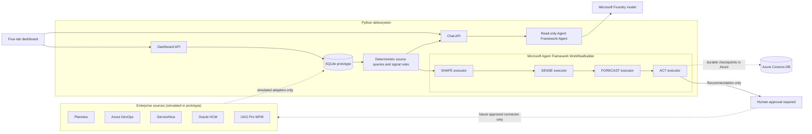

# Delivery Twin source-system prototype

This Python 3.10+ prototype turns the source-system layer in the Delivery Twin pitch into a runnable solution using synthetic data. Microsoft Agent Framework orchestrates the SHAPE → SENSE → FORECAST → ACT lifecycle; current source data remains in SQLite. It does not connect to enterprise systems or write changes back.

## Included source systems

| Source | Source-specific tables | Example data |
|---|---|---|
| Planview | `planview_projects`, `planview_milestones`, `planview_resource_assignments` | Customer 360 Q4 baseline, 7.5 of 8.0 FTE |
| Azure DevOps | `ado_projects`, `ado_sprints`, `ado_work_items` | Customer profile integrations and unplanned scope |
| ServiceNow | `servicenow_incidents`, `servicenow_change_requests` | Customer profile reconciliation incident and identity-matching change in CAB review |
| Oracle HR / HCM | `oracle_workers`, `oracle_worker_skills` | Customer data, CRM integration, identity resolution, and privacy skills |
| UKG Pro WFM | `ukg_shifts`, `ukg_time_entries`, `ukg_pto_requests` | Lead engineer's 16 weekly support hours and 40 approved PTO hours |

The shared delivery model holds initiatives, milestones, people, and skills; `source_entity_map` is available for mapping real source identifiers to shared entities. `source_systems` and `ingestion_runs` record connector mode and load history. See [`deliverytwin/schema.sql`](deliverytwin/schema.sql).

## Run

From this folder:

```powershell
python -m pip install -r requirements.txt
python -m deliverytwin demo
```

The command creates `deliverytwin.db`, seeds all five simulated sources, and prints the report after it passes through the Agent Framework workflow. The cross-system finding is deterministic and transparent: it flags the combined condition of at least 8 weekly production-support hours, 32 unplanned story points, and a blocking change at least 7 days old.

Useful separate steps:

```powershell
python -m deliverytwin --db demo.db init
python -m deliverytwin --db demo.db seed-demo
python -m deliverytwin --db demo.db report
python -m deliverytwin serve
python -m unittest discover -s tests -v
```

`serve` starts a dashboard at `http://127.0.0.1:8765/`; the SHAPE, SENSE, FORECAST, and ACT stages are separate keyboard-accessible tabs. The dashboard starts blank; click **Simulate next sprint** on SENSE once per sprint to load and advance deterministic sample records across Planview, Azure DevOps, ServiceNow, and UKG. Each sprint refreshes the sensed scope, support load, incidents, and CAB age; the forecast estimate and recovery recommendation update from those values. On SHAPE, **Clear all demo data** permanently deletes all rows (including source registrations, history, and approvals) from the selected local SQLite database while preserving its schema. The action requires browser confirmation. Stop the server with Ctrl+C. Pass `--db PATH` before the subcommand to use a different SQLite file. Demo dates are generated relative to the current date.

## Architecture



Each graph stage is a deterministic executor; no LLM is required to run the demo. The per-sprint FORECAST uses a deterministic heuristic over the current sample records, while ACT recalculates option confidence and selects an advisory recommendation. Neither stage requests a real approval or writes back to any source.

The dashboard includes a read-only chat backed by Microsoft Agent Framework and either Microsoft Foundry or the OpenAI Chat Completions API. It sends the current report snapshot and bounded conversation history to the configured model; it has no tools and cannot write to source systems. To enable Foundry locally, set `FOUNDRY_PROJECT_ENDPOINT` and `FOUNDRY_MODEL`, then authenticate with Azure CLI:

```powershell
$env:FOUNDRY_PROJECT_ENDPOINT = "https://<resource>.services.ai.azure.com/api/projects/<project>"
$env:FOUNDRY_MODEL = "<model-deployment-name>"
az login
python -m deliverytwin serve
```

In Azure, configure a managed identity with inference permissions for the Foundry project. Without the endpoint and model settings, the chat stays visible but reports that it is not configured. Add Entra ID authentication and rate limiting before exposing this prototype's chat API to users; the sample server does not implement application authentication.

Alternatively, configure `OPENAI_API_KEY` in the server process environment to use the OpenAI fallback. Do not put API keys in source files or share them in chat; restart the server after configuring either provider.

The local workflow uses in-memory checkpoints. For a deployed instance, set `AZURE_COSMOS_ENDPOINT` to use the Agent Framework Cosmos checkpoint provider; optionally set `AZURE_COSMOS_DATABASE_NAME` and `AZURE_COSMOS_CONTAINER_NAME`. Authentication uses `DefaultAzureCredential`, so configure a managed identity and grant it the required Cosmos DB data-plane permissions. The current Cosmos provider package is a prerelease: pin and validate it for your target environment before production use. The SQLite source-data database remains a prototype/demo store; use a managed relational database and real, least-privilege source adapters before production use.

## SHAPE intake demo

The SHAPE tab has a five-step intake flow: messy request → clarification questions
(architecture, data, security, reuse) → 6D delivery fingerprint matched to past initiatives →
explainable ROM (P50 4,450 h, P80 4,950 h, 14% integration buffer) → feasible commitment
(7.5 of 8.0 FTE, 31 March, 84% confidence) with an Approve gate.

Endpoints: `POST /api/intake/analyze`, `/api/intake/evaluate`, `/api/intake/approve`,
`GET /api/intake/baseline`. Approval is recomputed server-side and stored only in the local
`baseline_approvals` table; source systems are never written to.

Caveats: "retrieval" is keyword overlap over seeded synthetic lessons (no embeddings or LLM),
and the ROM numbers are calibrated synthetic data that deterministically reproduce the deck figures.

## Azure container image

The included `Dockerfile` runs the synthetic-data dashboard on port 8000, suitable for a prototype deployment to Azure Container Apps. Configure the Container Apps HTTP health probe to use `/healthz`. Build and run locally:

```powershell
docker build -t deliverytwin .
docker run --rm -p 8000:8000 deliverytwin
```

For Azure, deploy the image to Container Apps, configure ingress on port 8000, set `FOUNDRY_PROJECT_ENDPOINT` and `FOUNDRY_MODEL` for chat, and set the Cosmos endpoint and managed identity when durable workflow checkpoints are required. The container stores its demo SQLite database in ephemeral local storage; do not use that storage for production source data.

## Safety and scope

Every registered source is marked `simulated`, with `writeback_enabled=0`. The application contains no live connectors, credentials, or write-back operations. The forecast uses a transparent deterministic heuristic over synthetic signals; it is not a Monte Carlo forecast or a production integration. Recovery recommendations are advisory only. Microsoft Agent Framework orchestrates the stages, but the optional LLM narrator and human approval/resume endpoint are not implemented.
